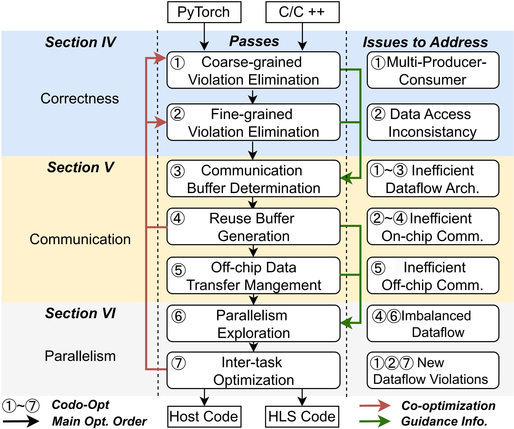

# CODO: An Automated Compiler for Comprehensive Dataflow Optimization

<p align="center">
  
</p>

CODO is an automated compiler for building efficient FPGA dataflow accelerators from high-level programs. It addresses the key challenges in large-scale dataflow design for HLS, including preserving correct streaming behavior, improving data movement efficiency, and balancing parallelism under resource constraints. Built on MLIR, CODO systematically detects and eliminates both coarse-grained and fine-grained dataflow violations, optimizes on-chip and off-chip communication, and uses design space exploration to improve performance while reducing resource consumption. 

CODO was accepted to ISCA 2026 and selected as an **ISCA 2026 Best Paper Award Finalist**.

This repository contains the artifact evaluation package for the CODO paper.

## 1. Clone the Repository

```sh
git clone git@github.com:sjtu-zhao-lab/codo.git -b codo-ae
cd codo
git submodule update --init --recursive --progress

# Alternative:
# git submodule update --init --recursive
```

---

## 2. Build Docker Image

```sh
docker build \
  --build-arg UID=$(id -u) \
  --build-arg GID=$(id -g) \
  -f Docker/Dockerfile.ae \
  -t codo_ae_image:v2 \
  .
```

---

## 3. Launch the Container

```sh
./run_ae.sh
```

---

## 4. Build the Project

### 4.1 Inside the Docker Container

#### Step 1: Build `torch-mlir`

```sh
cd third-party/torch-mlir/
python3 -m venv mlir_venv
source mlir_venv/bin/activate

python3 -m pip install --upgrade pip
python3 -m pip install -r requirements.txt

cmake -GNinja -Bbuild \
  -DCMAKE_BUILD_TYPE=Release \
  -DPython3_FIND_VIRTUALENV=ONLY \
  -DLLVM_ENABLE_PROJECTS=mlir \
  -DLLVM_EXTERNAL_PROJECTS="torch-mlir" \
  -DLLVM_EXTERNAL_TORCH_MLIR_SOURCE_DIR="$PWD" \
  -DMLIR_ENABLE_BINDINGS_PYTHON=ON \
  -DLLVM_TARGETS_TO_BUILD=host \
  externals/llvm-project/llvm

pip install pybind11==2.11.1
cmake --build build

cd ../..
```

---

#### Step 2: Build CODO

```sh
./compail.sh
```

---

## 5. Example Workflow (GPT-2)

Taking the GPT-2 model as an example, the following steps demonstrate how to perform optimized compilation and correctness verification using CODO.

> **Note**:
>
> * When optimizing CNN models, set `codo-opt=graph`.
> * `codo-translate -emit-vitis-host` generates the host file.
> * `codo-translate -emit-vpp-link` generates the configuration file.

---

### Step 1: Navigate to the Verification Directory

```sh
cd ./experiments/verify
```

---

### Step 2: Set Environment Variables

```sh
export PYTHONPATH=""
export PYTHONPATH=$PYTHONPATH:/home/devuser/workspace/third-party/torch-mlir/build/tools/torch-mlir/python_packages/torch_mlir
```

---

### Step 3: Generate Initial MLIR File

```sh
python gen_mlir_designs.py \
  --benchmark transformers \
  --model GPT2 \
  --model-folder pymodels \
  --output-path ./designs
```

The generated MLIR file is located at:

```
/home/devuser/workspace/experiments/verify/designs/GPT2/mlir/input/GPT2.mlir
```

---

### Step 4: Optimize MLIR with CODO

```sh
/home/devuser/workspace/build/bin/codo-opt \
  -codo-mm-opt="top-func=main_graph debug-point=10" \
  ./designs/GPT2/mlir/input/GPT2.mlir \
  -o ./designs/GPT2/mlir/kernel/GPT2.mlir
```

The optimized MLIR file will be saved at:

```
./designs/GPT2/mlir/kernel/GPT2.mlir
```

---

### Step 5: Convert MLIR to C++ (Kernel)

```sh
/home/devuser/workspace/build/bin/codo-translate \
  -emit-vitis-hls \
  ./designs/GPT2/mlir/kernel/GPT2.mlir \
  -o ./designs/GPT2/hls/src/GPT2.cpp
```

---

### Step 6: Generate MLIR for Testbench (Verification)

```sh
/home/devuser/workspace/build/bin/codo-opt \
  ./designs/GPT2/mlir/input/GPT2.mlir \
  -codo-verify-pipeline \
  > ./designs/GPT2/mlir/host/GPT2.mlir
```

---

### Step 7: Convert Testbench MLIR to C++

```sh
/home/devuser/workspace/build/bin/codo-translate \
  ./designs/GPT2/mlir/host/GPT2.mlir \
  -emit-vitis-hls \
  -vitis-hls-weights-dir="./designs/GPT2/hls/data" \
  -vitis-hls-is-host=true \
  -o ./designs/GPT2/hls/src/GPT2_tb.cpp

python fix_testbench.py \
  ./designs/GPT2/hls/src/GPT2.cpp \
  ./designs/GPT2/hls/src/GPT2_tb.cpp
```

---

### Step 8: Compile the Testbench

```sh
export PRJ_PATH=./designs/GPT2/hls

g++ \
  ./designs/GPT2/hls/src/GPT2_tb.cpp \
  ./designs/GPT2/hls/src/GPT2.cpp \
  -lm \
  -I${XILINX_HLS}/include \
  -o ./designs/GPT2/hls/GPT2.bin
```

---

### Step 9: Run Correctness Verification

```sh
ulimit -s unlimited
./designs/GPT2/hls/GPT2.bin
```

If the output shows:

```
PRJ_PATH: ./designs/GPT2/hls
```

then the correctness verification has passed successfully.

---

## 6. Synthesis and On-Board Validation

This section uses **GPT-32 Prefill** as a concrete example and shows how to
compile the released HLS kernel, link an Alveo U280 `xclbin`, build the host
program, and run one kernel invocation on the FPGA.

> **Scope of this example**
>
> The released `experiments/fig-9/gpt-32-prefill` host is a kernel-level
> performance harness. It allocates zero-initialized input and weight buffers,
> invokes `main_graph` once, and reports the OpenCL event time. It does **not**
> load a GPT-2 checkpoint, execute all 24 GPT-2 Medium layers, maintain a KV
> cache, generate tokens, copy an output tensor back to the host, or compare
> results against a numerical reference. Therefore, this procedure validates
> that the released kernel can be built, programmed, and executed; it is not an
> end-to-end GPT-2 inference or correctness-validation workflow.

### 6.1 Hardware and Software Requirements

The example was prepared for the following environment:

- AMD Alveo U280 (`xcu280-fsvh2892-2L-e`)
- Vitis/Vivado/Vitis HLS 2023.2
- XRT installed on the machine connected to the FPGA
- U280 platform `xilinx_u280_gen3x16_xdma_1_202211_1`
- A compatible U280 shell installed on the card
- GNU Make and a C++14 compiler

Hardware linking can take several hours and requires substantial memory and
disk space. The commands below should be run on a machine where Vitis, XRT,
and the U280 platform are installed. The Docker environment described above is
intended primarily for the compiler and HLS workflows; on-board execution also
requires access to the host's XRT installation and PCIe device.

Set up the toolchain. Adjust the installation paths for your machine:

```sh
source /path/to/Xilinx/Vitis/2023.2/settings64.sh
source /opt/xilinx/xrt/setup.sh

export PLATFORM=xilinx_u280_gen3x16_xdma_1_202211_1
export PLATFORM_REPO_PATHS=/opt/xilinx/platforms${PLATFORM_REPO_PATHS:+:$PLATFORM_REPO_PATHS}
```

Confirm that Vitis can find the platform and that XRT can see the card:

```sh
platforminfo --platform "$PLATFORM"
xbutil examine

# Replace this value with a BDF listed by `xbutil examine`.
export DEVICE_BDF=0000:86:00.1
xbutil examine --device "$DEVICE_BDF" --report platform
```

The `--device` option is required when multiple accelerator cards are present.
The platform reported for the selected device must be compatible with
`xilinx_u280_gen3x16_xdma_1_202211_1`. If it is not, install the matching
platform and shell before building or programming the device.

### 6.2 GPT-32 Prefill Sources

Starting from the repository root:

```sh
cd experiments/fig-9/gpt-32-prefill
```

The example consists of:

- `gpt-32_16x16.cpp`: HLS kernel source; the top function is `main_graph`.
- `host.cpp`: OpenCL host program that allocates buffers and launches the
  kernel once.
- `connectivity.cfg`: maps the 24 kernel memory interfaces to U280 HBM banks
  0 through 23.
- `Makefile`: builds `kernel.hw.xo`, `kernel.hw.xclbin`, and `host.exe`.
- `report/main_graph_csynth.rpt`: the released reference HLS synthesis report.

The host uses the standard Xilinx `xcl2` helper from the
[Vitis Acceleration Examples](https://github.com/Xilinx/Vitis_Accel_Examples/tree/2023.2/common/includes/xcl2).
Download the Vitis 2023.2 version into the shared Fig. 9 directory before
building the host:

```sh
mkdir -p ../xcl2
wget -O ../xcl2/xcl2.hpp \
  https://raw.githubusercontent.com/Xilinx/Vitis_Accel_Examples/2023.2/common/includes/xcl2/xcl2.hpp
wget -O ../xcl2/xcl2.cpp \
  https://raw.githubusercontent.com/Xilinx/Vitis_Accel_Examples/2023.2/common/includes/xcl2/xcl2.cpp
```

The resulting layout is:

```text
experiments/fig-9/xcl2/xcl2.hpp
experiments/fig-9/xcl2/xcl2.cpp
```

### 6.3 Compile the Kernel to an XO File

The compile stage runs HLS for `main_graph` and packages the resulting RTL as
`kernel.hw.xo`:

```sh
v++ \
  -s \
  -t hw \
  --platform "$PLATFORM" \
  --temp_dir ./all_builds/hw \
  --report_dir ./all_logs/hw \
  --log_dir ./all_logs/hw \
  -c \
  -k main_graph \
  -I. \
  -o kernel.hw.xo \
  gpt-32_16x16.cpp
```

Equivalent Make target:

```sh
make kernel.hw.xo
```

Check the generated synthesis reports before continuing:

```sh
find . -type f \( \
  -name '*csynth.rpt' -o \
  -name '*compile_summary*' \
\)
```

The checked-in `report/main_graph_csynth.rpt` is a reference report from the
artifact build. Vitis writes the top-level compile summary in the current
directory and detailed reports under `all_logs/` and `all_builds/`.

### 6.4 Link the XO into a U280 XCLBIN

The link stage performs Vivado synthesis, placement, routing, and xclbin
packaging. `connectivity.cfg` assigns `main_graph` arguments `vv834` through
`vv847` to HBM banks 0 through 23.

```sh
v++ \
  -s \
  -t hw \
  --platform "$PLATFORM" \
  --temp_dir ./all_builds/hw \
  --report_dir ./all_logs/hw \
  --log_dir ./all_logs/hw \
  -l \
  --config connectivity.cfg \
  --profile.data all:all:all \
  -o kernel.hw.xclbin \
  kernel.hw.xo
```

The profiling option may emit warnings about trace infrastructure crossing
SLRs or the number of trace monitors. These warnings do not by themselves
indicate that linking has failed. `--profile.data all:all:all` reproduces the
profiling configuration used for the artifact build; it may be removed when
data-transfer profiling is not required.

Check the generated link summary:

```sh
find . -type f -name '*link_summary*'
```

Inspect the packaged kernel signature, HBM mapping, target platform, requested
clock, and achieved implementation clock:

```sh
xclbinutil --info --input kernel.hw.xclbin | tee xclbin-info.txt
```

The kernel signature should contain exactly 24 pointer arguments, in this
order:

```text
vv834, vv835_1, vv835_2, vv836, vv837, vv838, vv839, vv840,
vv841, vv842_1, vv842_2, vv843_1, vv843_2, vv844_1, vv844_2,
vv845_1, vv845_2, vv845_3, vv845_4, vv846_1, vv846_2,
vv846_3, vv846_4, vv847
```

### 6.5 Build the Host Program

From `experiments/fig-9/gpt-32-prefill`, compile the host against XRT and the
Xilinx HLS headers:

```sh
g++ \
  -g \
  -std=c++14 \
  -I"$XILINX_XRT/include" \
  -I"$XILINX_VIVADO/include" \
  -I"$XILINX_HLS/include" \
  -I../xcl2 \
  host.cpp ../xcl2/xcl2.cpp \
  -L"$XILINX_XRT/lib" \
  -lOpenCL \
  -lxrt_coreutil \
  -lrt \
  -luuid \
  -pthread \
  -o host.exe
```

The checked-in Makefile assumes that Vitis HLS is installed under
`/home/tools/Vitis_2023.2`. If your installation uses that path and the `xcl2`
helper is in place, the equivalent Make target is:

```sh
make host
```

The host creates one buffer for each kernel argument, places them in HBM banks
0 through 23, migrates all buffers to the FPGA, and sets OpenCL kernel arguments
0 through 23 in the same order as the xclbin metadata.

### 6.6 Run on the U280

Ensure hardware emulation is disabled and verify the device immediately before
running:

```sh
unset XCL_EMULATION_MODE
xbutil examine
```

Program the first compatible Xilinx accelerator found by the host and execute
one `main_graph` invocation:

```sh
./host.exe ./kernel.hw.xclbin | tee gpt32-prefill-hw.log
```

A successful run contains messages similar to:

```text
Trying to program device[0]: ...
Device[0]: program successful!
| main_graph              |             <time-ns> |
TEST PASSED
```

`TEST PASSED` in this host means that device programming, buffer migration, and
the kernel launch completed without an OpenCL error. It does not indicate a
numerical comparison against GPT-2 reference outputs.

If multiple Xilinx accelerator cards are installed, note that this host scans
the devices in XRT enumeration order and uses the first device that accepts the
xclbin. Use `xbutil examine` to check the device order before running.

### 6.7 Timing Boundary

The reported value is obtained from `CL_PROFILING_COMMAND_START` and
`CL_PROFILING_COMMAND_END` for the single `enqueueTask(main_graph)` event. It
includes the execution of one `main_graph` kernel invocation and excludes:

- xclbin loading and FPGA programming;
- host buffer allocation;
- host-to-device buffer migration;
- device-to-host result migration; and
- any multi-layer orchestration, KV-cache management, token sampling, or
  autoregressive decoding.

This on-board event time should not be confused with the latency estimate in
`main_graph_csynth.rpt`. The synthesis report is an HLS estimate, while the host
prints the duration measured by XRT on the physical device.

### 6.8 Rebuild and Other Fig. 9 Configurations

To remove generated products and rebuild from source:

```sh
make cleanall
make kernel.hw.xo
make host
```

Run the explicit `v++ -l` command in Section 6.4 between `make kernel.hw.xo`
and `make host` to generate `kernel.hw.xclbin`. The current Makefile link rule
passes `kernel.hw.xo` twice and causes Vitis to report a duplicate-input
warning; the explicit command in Section 6.4 supplies the XO exactly once.

The same compile, link, and run flow applies to the other directories under
`experiments/fig-9`. Use the kernel source, connectivity file, and host program
from the selected directory; do not mix files between configurations because
their kernel signatures and HBM mappings differ.

---

## Citation

```bibtex
@misc{zhang2026codo,
      title={CODO: An Automated Compiler for Comprehensive Dataflow Optimization}, 
      author={Weichuang Zhang and Yiquan Wang and Xinzhou Zhang and Chi Zhang and Yu Feng and Xiaofeng Hou and Chao Li and Jieru Zhao and Minyi Guo},
      year={2026},
      eprint={2604.12618},
      archivePrefix={arXiv},
      primaryClass={cs.AR},
      url={https://arxiv.org/abs/2604.12618}, 
}
```

## Acknowledgements

Some parts of CODO were modified, extended, and/or borrowed from [HIDA](https://github.com/UIUC-ChenLab/ScaleHLS-HIDA), [Allo](https://github.com/cornell-zhang/allo), and [StreamHLS](https://github.com/UCLA-VAST/Stream-HLS).
